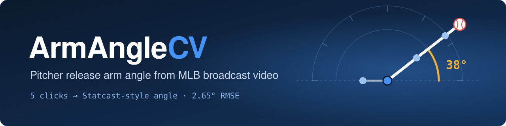
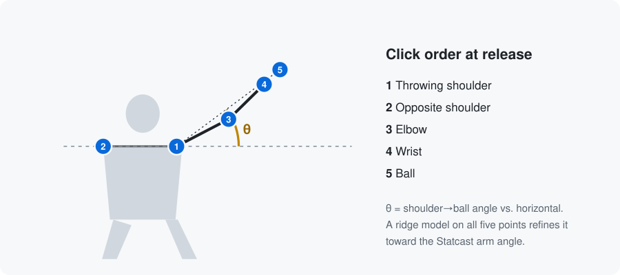
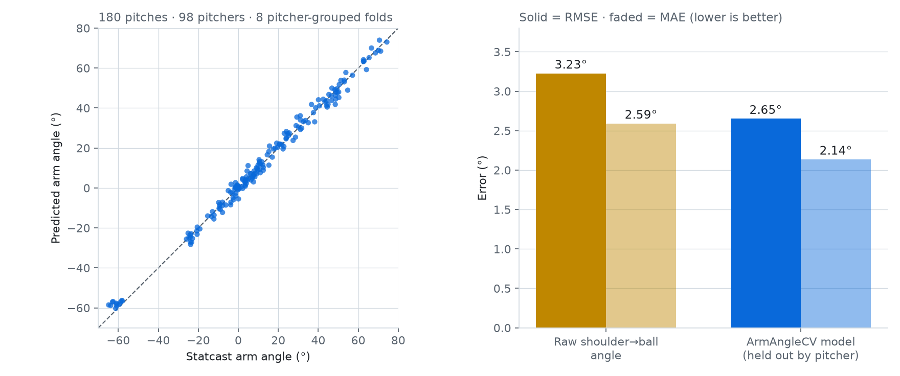

<p align="center">
  
</p>

<p align="center">
  <a href="https://github.com/charliecapretta/ArmAngleCV/actions/workflows/checks.yml"></a>
  
  <a href="MODEL_CARD.md"></a>
  <a href="LICENSE"></a>
</p>

<p align="center">
  <a href="#how-it-works">How it works</a> ·
  <a href="#quickstart">Quickstart</a> ·
  <a href="#results">Results</a> ·
  <a href="#data">Data</a> ·
  <a href="MODEL_CARD.md">Model card</a> ·
  <a href="#license--citation">Citation</a>
</p>

ArmAngleCV estimates a pitcher's **release arm angle** from a single video frame.
Pick the release frame, click five points, and get a Statcast-style angle in degrees —
about **2.65° RMSE** against Statcast on pitchers the model never saw.

> [!IMPORTANT]
> **Validated scope: MLB center-field broadcast footage.** College, high-school,
> side-view, and recruiting-reel accuracy is unverified. See the [model card](docs/MODEL_CARD.md).

## How it works

<p align="center">
  
</p>

1. **Find release.** Scrub the clip with the timeline, arrow keys, and neighboring
   frames, then lock the release frame.
2. **Mark five points.** The view zooms to the pitcher automatically. Click throwing
   shoulder, opposite shoulder, elbow, wrist, then ball.
3. **Estimate.** The app shows the raw shoulder-to-ball angle and the model estimate.
   The model is a standardized ridge regression on 12 features from all five points,
   with coordinates rescaled to 720 px height so resizing the video doesn't change the result.
4. **Save and export.** Each saved pitch becomes a CSV row; export a whole session at once.

| Step | Where | Writes |
|---|---|---|
| Fetch MLB examples *(optional)* | `scripts/fetchUiTestBatch.py` | `pitches/` |
| Label and analyze | `armangle/labelServer.py` + `web/` | `analysisLabels.csv` |
| Predict | `armangle/angleInputs.py` + `model/armAngleModelResolutionSafe.joblib` | in-app estimate |
| Export | **Export session CSV** / `scripts/predictLabels.py` | session CSV |
| Retrain and evaluate | `scripts/evaluateAngleInputs.py` | `reports/` |
| Verify release | `tools/checkRelease.py` | — |

## Quickstart

Use **Python 3.12**. No GPU or neural-network weights are needed.

```bash
python3.12 -m venv .venv
source .venv/bin/activate          # Windows: .venv\Scripts\Activate.ps1
python -m pip install -r requirements.txt
python -m armangle
```

Open **http://127.0.0.1:8777/index.html** and choose **Upload a video** or **Try MLB examples**.

To download one fixed MLB example clip first (omit `--limit 1` for all 12):

```bash
python -m pip install -r requirements-fetch.txt
python scripts/fetchUiTestBatch.py --limit 1
```

<details>
<summary><b>Upload limits and labeling controls</b></summary>

- MP4 up to 100 MB, 60 s, 1920 × 1080, 60 fps, and 3,600 frames. Uploads are copied
  to `uploads/` on your computer; nothing leaves your machine.
- Drag a point to adjust it. Scroll to zoom at the cursor, shift-drag to pan, and
  press `Z` to toggle between the pitcher crop and the full frame.
- If the ball is hidden, mark it unavailable. It saves as an occluded annotation
  but produces no model estimate.
- Quality notes record uncertainty; they are not a confidence score.
- Use short clips: frames are decoded into memory.

</details>

## Results

<p align="center">
  <picture>
    <source media="(prefers-color-scheme: dark)" srcset="assets/validation-dark.png">
    
  </picture>
</p>

Eight outer folds grouped by pitcher, so no pitcher appears in both training and test:

| Method | RMSE | MAE |
|---|---:|---:|
| Raw shoulder-to-ball angle (no model) | 3.227° | 2.592° |
| **ArmAngleCV `manual-v1`** | **2.653°** | **2.137°** |

These are development cross-validation results on 180 pitches from 98 pitchers
across all 30 parks, not an external benchmark. `tools/checkRelease.py` reproduces
them exactly and verifies the shipped model's checksums.

**Limits:** the extreme low-slot tail (below −30°) has 12 pitches from one pitcher,
and there is no calibrated per-pitch confidence interval.
Details are in the [model card](docs/MODEL_CARD.md).

## Data

| File | Contents |
|---|---|
| `data/manual-v1/labels.csv` | Frozen 184-row snapshot the shipped model was trained on. Do not edit. |
| `data/labels.csv` | Current development labels (192 complete, 103 pitchers). |
| `data/savant_data.csv` | Baseball Savant export, Aug 10–16, 2026, used to select pitches. |
| `data/uiTestBatch.json` | Identifiers for the 12 MLB example clips. |
| `analysisLabels.csv` | *Yours, created locally.* Saved analyses; git-ignored. |

Arm-angle targets and pitch metadata come from [Baseball Savant](https://baseballsavant.mlb.com/).
No broadcast video is included. See [DATA_SOURCES.md](docs/DATA_SOURCES.md) for attribution
and the [V1 CSV contract](docs/V1_CSV.md) for export fields.
This project is not affiliated with or endorsed by MLB.

## Project layout

```
ArmAngleCV/
├── armangle/             # core package — `python -m armangle` starts the local app
│   ├── labelServer.py        # local server and API
│   ├── angleInputs.py, features.py, AnglePredictor.py   # model inputs and estimator
│   └── analysisExport.py, videoUploads.py, savantUtils.py, releaseTiming.py
├── web/                  # browser UI: labelTool.html, labelTool.js, workspace.css
├── scripts/              # command-line tools: fetch clips, predict, evaluate
├── model/                # shipped ridge models + checksummed manifest
├── data/                 # labels, frozen manual-v1 snapshot, Statcast export
├── hosted/  deploy/      # optional AWS web app and its deployment config
├── phase4/               # experimental automatic keypoints
├── tools/  tests/        # release checks, bundle builders, test suite
├── docs/                 # model card, data sources, guides
└── assets/  reports/     # README images, validation outputs
```

## Development

```bash
python -m unittest discover -s tests -v      # includes a real first-run server test
node --test tests/labelTool.test.cjs          # browser workflow logic (Node 22)
python tools/checkRelease.py                  # model/data checksums and grouped score
```

| Status | Features |
|---|---|
| ✅ Supported | Manual release selection, five-point labeling, angle prediction, CSV export |
| 🧪 Experimental | Automatic keypoints (`phase4/`) and release detection |
| 🗓️ Planned | Independent validation batch; college footage validation |

See [research workflows](docs/RESEARCH.md) and the [research history](docs/RESEARCH_HISTORY.md).

<details>
<summary><b>Hosted deployment (AWS)</b></summary>

A separate Flask/Gunicorn runtime in `hosted/` serves the analysis workspace with
per-visitor isolation, SQLite saves, private frame storage, upload limits, and
expiry/deletion. The local app is unaffected.

- [Elastic Beanstalk guide](docs/AWS_BEANSTALK.md) · build with `tools/prepareBeanstalk.py`
- [Lightsail guide](docs/AWS_LIGHTSAIL.md)
- [Optional S3 original storage](docs/S3_SETUP.md)
- [Privacy and storage](docs/PRIVACY_STORAGE.md)
- [Public release checklist](docs/PUBLIC_RELEASE.md)

</details>

## License & citation

Code is released under the [MIT license](LICENSE). Statcast data remains subject to
MLB's terms. If you use ArmAngleCV in your work, cite it with GitHub's
**Cite this repository** button or:

```bibtex
@software{capretta_armanglecv_2026,
  author = {Capretta, Charlie},
  title  = {ArmAngleCV: Pitcher release arm angle from broadcast video},
  year   = {2026},
  url    = {https://github.com/charliecapretta/ArmAngleCV}
}
```
